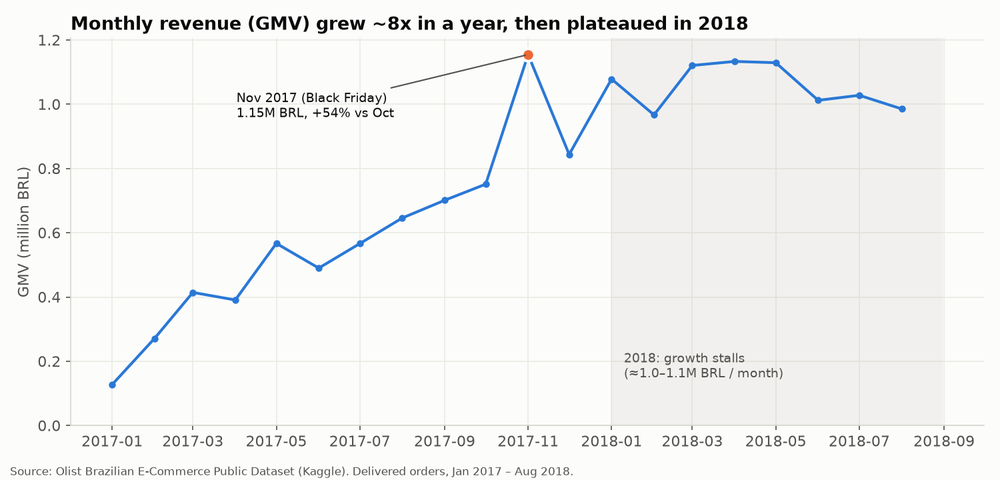
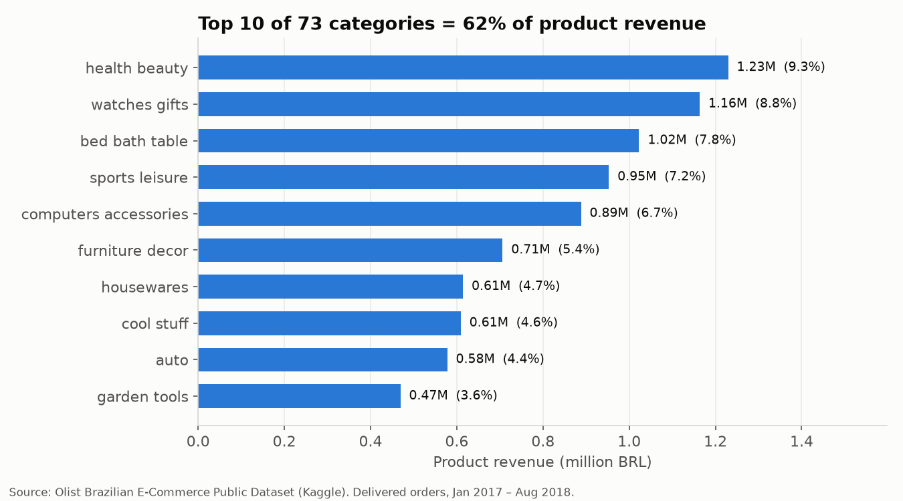
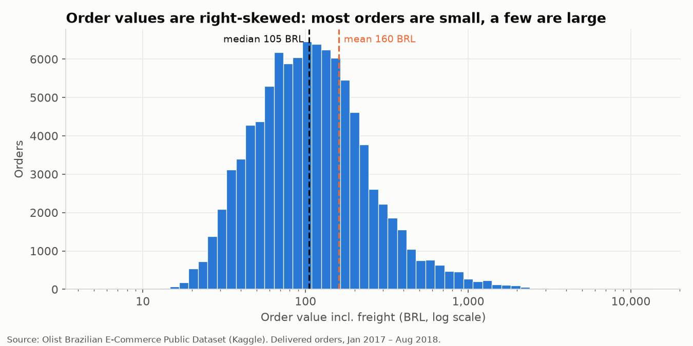
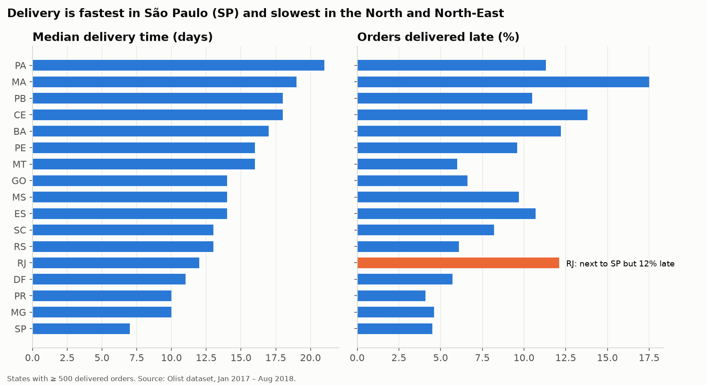
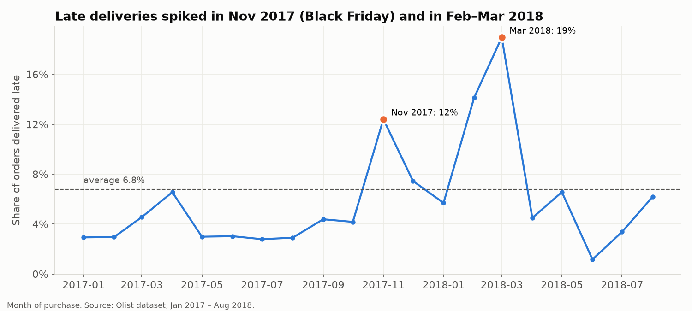
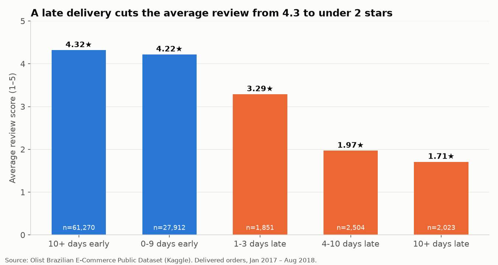
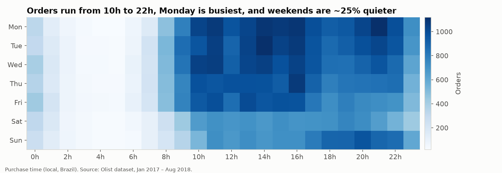
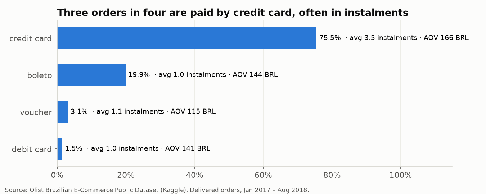

# Brazilian E-Commerce Analysis: Growth, Delivery and Customer Satisfaction

**An end-to-end data analytics project on ~100,000 real orders from Olist, Brazil's largest department-store marketplace (2016–2018).**

The SQL pipeline cleans and models 8 raw tables. A Python EDA then answers one business question:
**the marketplace grew fast, so what is holding it back?**



---

## Key findings

| # | Finding | Evidence |
|---|---------|----------|
| 1 | **Fast growth, then a plateau.** Monthly revenue rose from 0.13M BRL (Jan 2017) to 1.08M BRL (Jan 2018), then stayed flat at ≈1.0–1.1M BRL a month through August 2018. | H1 2018 GMV was 6.44M BRL, against 2.26M BRL in H1 2017 (×2.8) |
| 2 | **Black Friday is the single biggest month.** November 2017 brought 7,289 orders and 1.15M BRL, **+54%** on October. | `a_monthly` |
| 3 | **Late delivery destroys satisfaction.** Orders delivered early average **4.32★**; orders more than 10 days late average **1.71★**, and **79%** of them get 1–2 stars. | `a_late_vs_review` |
| 4 | **Logistics break under peak load.** The late-delivery rate averages 6.8%, but reached **12%** in Nov 2017 and **19%** in March 2018. | chart 5 |
| 5 | **Geography drives delivery time.** São Paulo customers wait a median **7 days** (4.5% late). Customers in the North and North-East wait 16–21 days. Rio de Janeiro is a surprise: close to São Paulo, yet **12.1%** of its orders arrive late and it averages **3.97★**. | `a_states` |
| 6 | **Almost no repeat customers.** Only **3.0%** of 93,358 customers ordered more than once, and they bring 5.6% of revenue. | `a_repeat` |
| 7 | **Revenue is concentrated.** The top 10 of 73 named categories make up **62%** of product revenue, led by health & beauty, watches & gifts, and bed/bath/table. | `a_categories` |
| 8 | **Credit card dominates.** 75.5% of orders are paid by card, at an average of 3.5 instalments. Boleto (bank slip) accounts for 19.9%. | `a_payments` |

### Recommendations
1. **Protect the review score during peaks.** Add carrier capacity before Black Friday and February–March, and warn customers early when an order will be late. Lateness is the strongest driver of bad reviews found in this data.
2. **Investigate Rio de Janeiro deliveries.** RJ's late rate is nearly three times São Paulo's over a similar distance, so the cause is probably operational (carrier or last mile) rather than geographic.
3. **Work on retention, not only acquisition.** With a 3% repeat rate, growth depends entirely on new customers, which helps explain the 2018 plateau. Follow-up offers to first-time buyers in the top categories are a low-cost test.
4. **Estimates are very cautious.** The median order arrives 12 days *before* its estimated date. Tighter, honest estimates could improve conversion without hurting reviews. This should be tested, not assumed.

---

## Dataset

| | |
|---|---|
| **Source** | [Brazilian E-Commerce Public Dataset by Olist (Kaggle)](https://www.kaggle.com/datasets/olistbr/brazilian-ecommerce). The same files are in [Olist's GitHub repository](https://github.com/olist/work-at-olist-data) |
| **Period** | Sept 2016 – Oct 2018 (analysis restricted to complete months: Jan 2017 – Aug 2018) |
| **Size** | 8 tables: 99,441 orders, 112,650 order items, 103,886 payments, 99,224 reviews, 32,951 products, 3,095 sellers |
| **Currency** | Brazilian real (BRL) |

```
customers ─┐
           ├── orders ──┬── order_items ── products ── category_translation
           │            │                └─ sellers
           │            ├── order_payments
           │            └── order_reviews
```

---

## Project structure

```
├── download_data.py          # fetches the 8 CSV files into data/
├── run_pipeline.py           # runs the SQL files in DuckDB, exports results to output/
├── sql/
│   ├── 01_staging.sql        # load as text, cast types, trim, rename
│   ├── 02_cleaning.sql       # fix or flag every data-quality issue
│   ├── 03_model.sql          # fact_orders and fact_order_items
│   ├── 04_quality_checks.sql # tests that must return 0
│   └── 05_analysis.sql       # one query per business question
├── eda.py                    # 8 charts → images/
└── images/
```

## How to run

```bash
pip install -r requirements.txt
python download_data.py      # ~64 MB
python run_pipeline.py       # builds olist.duckdb and output/*.csv
python eda.py                # writes images/*.png
```

The SQL is written for **DuckDB**, whose dialect is close to PostgreSQL. To port it to SQL Server, replace
`TRY_CAST` with SQL Server's `TRY_CAST` / `TRY_CONVERT`, `DATE_DIFF('day', a, b)` with `DATEDIFF(day, a, b)`,
`MEDIAN()` with `PERCENTILE_CONT(0.5)`, and `ARG_MAX()` with a `ROW_NUMBER()` subquery.

---

## Data cleaning

Each problem was found by profiling the raw files first. The rule was: **fix what is safe to fix, flag the rest, never delete silently.**

| Issue found | Rows affected | Treatment |
|---|---|---|
| All columns load as text; dates and amounts unparsed | all | `TRY_CAST` to TIMESTAMP / DECIMAL / INTEGER in staging |
| Column names misspelled in the source (`product_name_lenght`) | 2 columns | Renamed in staging |
| Products without a category | 610 products | Labelled `unknown` (1,603 order items) |
| Categories missing from the translation table | 2 categories | Translated manually (`pc_gamer`, `portable_kitchen_appliances`) |
| Several reviews for the same order | 99,224 reviews for 98,673 orders | Kept the most recent review per order (`ROW_NUMBER()`) |
| Payment type `not_defined` or value 0 | 3 + 9 rows | Removed from payments |
| Instalments = 0 | 2 rows | Set to 1 |
| Orders marked *delivered* but with no delivery date | 8 orders | Flagged `delivery_data_ok = false`, excluded from delivery metrics |
| Nearly empty months at both ends (e.g. Sept 2018: 16 orders) | 6 months | Flagged `is_complete_month = false`, excluded from trends |
| `customer_id` differs on every order for the same person | all | Used `customer_unique_id` for repeat-customer analysis |
| Orders with no items (mostly cancelled or unavailable) | 775 orders | Kept, excluded by the `delivered` filter |

**Quality checks** (`04_quality_checks.sql`) confirm 0 duplicate orders, 0 orders lost in joins, 0 unparsed dates,
0 orders without a customer and 0 negative prices. There is also 1 review per order.
312 orders have a paid amount that differs from items + freight by more than 1 BRL. This is documented, not corrected.

Analysis scope after cleaning: **96,211 delivered orders** in complete months, **15.38M BRL** GMV,
average order value **160 BRL** (median 105 BRL).

---

## Exploratory analysis

### Revenue is concentrated in a few categories


### Order values are right-skewed
The mean (160 BRL) is well above the median (105 BRL). This is why the median, not the mean, describes a "typical" order.


### Delivery time depends on where the customer lives


### Late deliveries spike at peak periods…


### …and late deliveries drive bad reviews


### When customers buy


### How customers pay


---

## Limitations
- **Correlation, not causation.** Late orders get worse reviews, but other factors (product quality, seller) may also play a part. A controlled analysis would be needed to measure the effect of lateness alone.
- The dataset is a **sample** released by Olist and anonymised. It does not cover all of Olist's activity, and absolute figures should not be read as the company's total revenue.
- The cause of the Feb–Mar 2018 delivery spike is not in the data. Possible explanations (carrier problems, regional events) are not verified.
- GMV here is items + freight on delivered orders. It excludes cancelled orders and refunds.

## Tools
SQL (DuckDB) · Python (pandas, NumPy, Matplotlib) · Git

## Author
**Yacouba Konaté** · [GitHub](https://github.com/Yacouba-konate450)

*Data licence: see the dataset's Kaggle page (CC BY-NC-SA 4.0). This project is for portfolio and educational use.*
